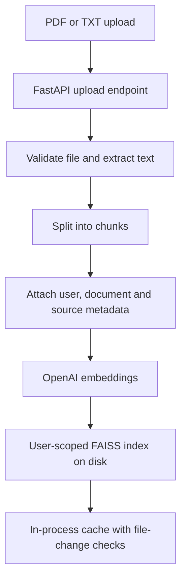
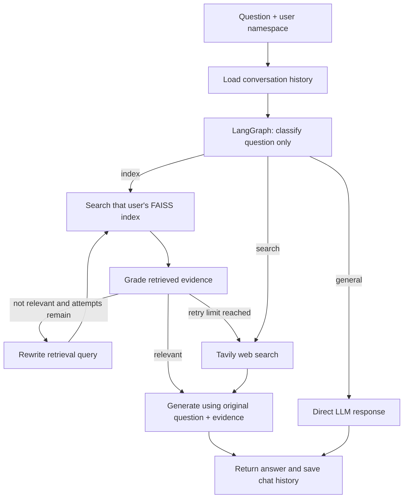

# Adaptive RAG

A document-question-answering API that chooses between a user's uploaded documents, a direct LLM answer, and web search. When document retrieval is selected, the system checks whether the retrieved text is relevant, rewrites a weak search query, and retries a bounded number of times.

The repository contains a FastAPI backend, a Streamlit chat interface, a LangGraph workflow, OpenAI models and embeddings, a persistent FAISS index, MongoDB-backed chat history, and Tavily web search.

## What the system does

- Accepts PDF and TXT uploads.
- Splits readable document text into overlapping chunks and embeds them.
- Stores chunks in a disk-backed FAISS index scoped to a user namespace.
- Routes questions to document retrieval, the general LLM, or web search.
- Grades retrieved evidence before generating a document-grounded answer.
- Rewrites the retrieval query when evidence is weak, with a maximum of three retrieval attempts by default.
- Keeps conversation history in MongoDB.

## Architecture

### Document ingestion



### Query flow



The classifier does **not** retrieve documents. Retrieval begins only when it selects the `index` route. The original user question is kept separately from the rewritten retrieval query so the final answer still addresses what the user actually asked.

## Routing rules

| Route | Used for | Path |
|---|---|---|
| `index` | Questions about uploaded material | Retrieve → grade → answer, or rewrite and retry |
| `general` | Conversation and stable common knowledge | Direct LLM response |
| `search` | Current or external information | Tavily search → answer from search results |

The classifier makes this choice from the question alone. A document-related question with no matching uploaded evidence can still reach web search after the retrieval limit is exhausted.

## Retrieval, persistence and user isolation

- **Persistent storage:** FAISS indexes are saved under `VECTORSTORE_DIR`, which defaults to `data/vectorstores/`. An index is loaded from disk when needed, so an API process restart does not by itself erase indexed documents.
- **User namespaces:** Each user ID is hashed into a filesystem-safe directory name. Uploads append to that user's index; query retrieval opens only that namespace.
- **Cache:** Loaded FAISS objects are cached in the process. The index file signatures are checked so an index changed by another process can be reloaded.
- **Write coordination:** A per-user file lock coordinates reads and writes to an index on a shared local filesystem.
- **Metadata:** Chunks include source filename, document ID, chunk number, user ID and the document description.

This is a practical persistent local-storage design, not a managed distributed vector database. Multiple workers must share the same persistent filesystem for the indexes to be visible to each other. For separate containers, ephemeral hosting disks, or larger deployments, use a shared vector service such as Qdrant instead. The active retrieval code currently uses FAISS; Qdrant is not the active backend.

The user ID is currently supplied by the API client in `X-User-ID` or the query request. It is a **namespace key, not authentication**. A production deployment must validate the caller's identity on the server and derive the namespace from verified credentials rather than trusting a caller-provided header.

## Retry and answer behavior

1. The first retrieval attempt searches with the original question.
2. If the grader says the evidence is not relevant, the query is rewritten and retrieval is repeated.
3. The workflow stops retrying after `MAX_RETRIEVAL_ATTEMPTS` attempts (default: `3`).
4. If evidence remains inadequate, the workflow tries web search instead of looping indefinitely.
5. The answer prompt receives both the original question and the retrieved context. It instructs the model to state when the evidence is insufficient rather than inventing facts.

Set `MAX_RETRIEVAL_ATTEMPTS` to a positive integer to change the limit. The prompt-level grounding instruction reduces unsupported answers but is not a formal guarantee of factual correctness.

## Main components

| Path | Responsibility |
|---|---|
| `src/api/routes.py` | Query and document-upload API endpoints |
| `src/rag/graph_builder.py` | LangGraph nodes and workflow edges |
| `src/tools/graph_tools.py` | Route selection and retry-limit decisions |
| `src/rag/retriever_setup.py` | Persistent per-user FAISS storage, cache and file locking |
| `src/rag/document_upload.py` | PDF/TXT parsing, chunking, metadata and indexing |
| `src/config/prompts.yaml` | Classification, grading, rewriting and answer prompts |
| `src/models/state.py` | State passed between graph nodes |
| `src/memory/chat_history_mongo.py` | MongoDB conversation history |
| `streamlit_app/pages/chat.py` | Chat and upload interface |
| `streamlit_app/utils/api_client.py` | Streamlit-to-FastAPI requests |

## API contract

### `POST /rag/documents/upload`

Multipart form field: `file`

Required headers:

- `X-Description`: a short description of the document.
- `X-User-ID`: the namespace into which the document should be indexed.

Supports `.pdf` and `.txt`. The response includes the generated document ID and number of indexed chunks. Scanned PDFs without an extractable text layer require OCR, which is not implemented here.

### `POST /rag/query`

JSON request:

```json
{
  "query": "What does the document say about indexing?",
  "session_id": "conversation-session",
  "user_id": "user-namespace"
}
```

`user_id` selects the document index; `session_id` selects conversation history. If `user_id` is omitted, the API uses `session_id` as the namespace.

## Failure cases and current limits

| Failure case | Current behavior / limitation |
|---|---|
| No document uploaded for this user | Retrieval has no index; after the bounded attempts, the workflow tries web search. |
| Retrieved chunks are unrelated | The grader rejects them; the query is rewritten up to the configured limit. |
| Tavily fails or returns no usable results | The answer node receives a message that no usable web results were available; the resulting answer may be limited. |
| OpenAI API key, quota or model call fails | The affected request can fail. There is no general retry/backoff policy for provider errors yet. |
| Scanned PDF or unsupported file type | Unsupported types are rejected; a PDF with no extractable text returns a readable error and needs OCR upstream. |
| API process restarts | Indexed documents remain if `VECTORSTORE_DIR` is on persistent storage. |
| Hosting platform uses ephemeral disk | Indexes can disappear when the platform replaces the instance. Mount persistent storage or use a shared vector service. |
| Multiple workers on separate filesystems | They do not share local FAISS files. Use shared persistent storage or a vector database service. |
| Two users upload similar documents | Their indexes remain separate when each request uses the correct, verified user namespace. |
| Caller spoofs `X-User-ID` | The current API does not verify identity itself. Add server-side authentication and authorization before exposing it publicly. |
| Two uploads for one user happen concurrently | File locking coordinates index updates on a shared local filesystem; deployment storage must support reliable file locks. |
| Answer contains unsupported claims | The prompt tells the model to disclose missing evidence, but no automatic final-answer faithfulness check is wired into the graph. Validate answers before treating them as authoritative. |
| Chat history database is unavailable | Query handling can fail because MongoDB is the configured chat-history store; no durable fallback is wired into the API path. |

## Technology actually used

- **Workflow:** LangGraph
- **LLM and embeddings:** LangChain OpenAI integration
- **Vector search:** FAISS, persisted to local disk and separated by user namespace
- **Web search:** Tavily
- **API:** FastAPI
- **Chat history:** MongoDB via Motor
- **Frontend:** Streamlit
- **Document loaders:** LangChain PDF and text loaders
- **Chunking:** Recursive character splitting, 1,000-character chunks with 150-character overlap

Qdrant configuration and an answer-verification prompt exist in the repository, but Qdrant is not the active vector store and the verification prompt is not currently connected to the graph. They are therefore not described as implemented features.

## Configuration

The backend expects provider credentials in environment variables:

- `OPENAI_API_KEY`
- `TAVILY_API_KEY`

Optional settings:

- `VECTORSTORE_DIR`: persistent index directory; defaults to `data/vectorstores`.
- `MAX_RETRIEVAL_ATTEMPTS`: retrieval-attempt limit; defaults to `3`.
- `MONGODB_URL`: MongoDB connection string; defaults to `mongodb://localhost:27017`.
- `MONGODB_DB_NAME`: MongoDB database name; defaults to `adaptive_rag`.

## Scope

This project demonstrates adaptive routing, relevance grading, query rewriting, bounded retrieval retries, web-search fallback, persistent user-scoped document indexes, and grounded generation. It is not yet a production-hardened multi-tenant service: authentication enforcement, provider retry/backoff, OCR, automated evaluation, and a connected final-answer faithfulness verifier remain future work.
