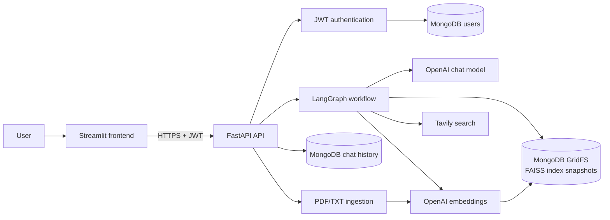
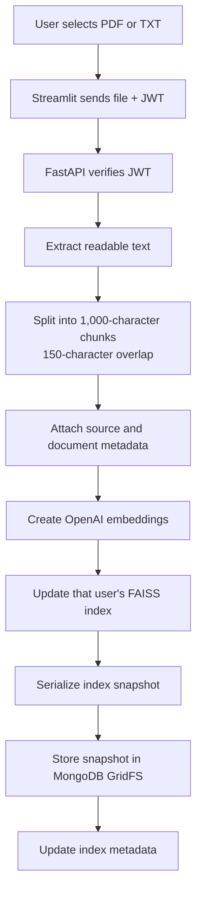
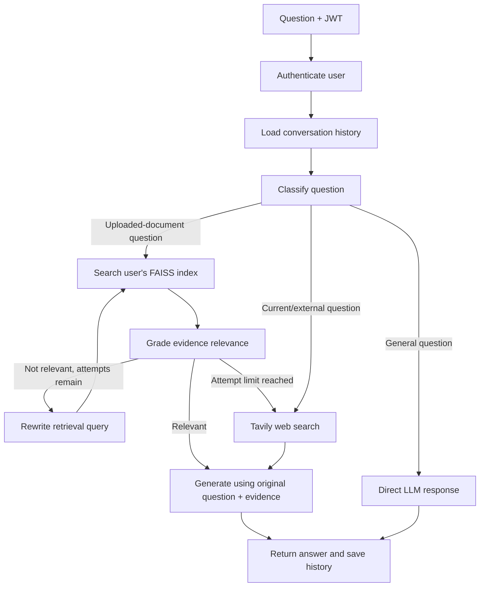

# Adaptive RAG

Adaptive RAG is a document-question-answering application that chooses how to answer a question instead of sending every request through the same retrieval pipeline.

A user can create an account, upload PDF or TXT files, and ask questions. The API decides whether the request should use that user's uploaded documents, go directly to the language model, or use web search. Document retrieval is checked before an answer is generated, and weak retrieval is retried only a bounded number of times.

## What is implemented

- Account registration and login using hashed passwords and signed JWT access tokens.
- Authenticated FastAPI endpoints for document upload and question answering.
- PDF/TXT text extraction and overlapping text chunking.
- OpenAI embeddings and FAISS similarity search.
- Persistent FAISS index snapshots stored in MongoDB GridFS, not only on the API server's local disk.
- Separate document indexes for each authenticated user.
- An in-process index cache, with MongoDB metadata used to detect updated snapshots.
- Per-user MongoDB leases to coordinate index reads and writes across API workers.
- LangGraph routing, relevance grading, query rewriting, and a configurable retrieval-attempt limit.
- Tavily web search for current/external questions and as a fallback when document retrieval remains weak.
- MongoDB-backed conversation history.
- Streamlit frontend that communicates with the FastAPI backend through a configurable URL.

## Architecture

### Services and data



### Document ingestion



### Query flow



The classifier runs before document retrieval. A general question does not incur a vector search. The original question is retained separately from any rewritten retrieval query, so the final response still answers what the user asked.

## Routing behavior

| Route | When it is selected | What happens |
|---|---|---|
| `index` | The question refers to a user's uploaded material | Retrieve → grade → answer, or rewrite and retry |
| `general` | Conversation or stable common knowledge | Direct LLM response |
| `search` | Current, time-sensitive, or external information | Tavily search → answer from returned context |

The classifier chooses a route from the question. The retrieval grader checks whether the returned text contains useful evidence for the original question.

## Persistent multi-user document storage

The active vector store is FAISS. Its serialized index snapshots are stored in **MongoDB GridFS** so uploaded documents are not tied to the lifetime of a Render instance's local filesystem.

- Each authenticated account has its own index namespace, derived from the immutable user ID in the verified JWT.
- Chunk metadata includes source filename, document ID, chunk number, and the owning user ID.
- After an upload, the updated FAISS index is serialized and written to GridFS. A MongoDB metadata record points to the latest snapshot.
- The API caches a loaded FAISS object in memory. It checks MongoDB metadata and reloads the snapshot if another worker has updated it.
- A per-user MongoDB lease serializes index updates across workers. A separate in-process lock prevents concurrent operations for the same user within one worker.
- Previous snapshots are retained so concurrent readers can finish safely. A periodic retention cleanup job is not implemented yet, so GridFS storage grows as users add documents.

This approach keeps FAISS while moving durable storage to MongoDB. It avoids relying on a paid persistent disk attached to the API host. MongoDB availability and sufficient GridFS storage are therefore required for document upload and retrieval.

## Authentication and user isolation

The Streamlit frontend no longer calls the old Rust authentication service. Registration and login are handled by FastAPI:

1. A user registers with a username and password.
2. The API stores a bcrypt password hash, never the plaintext password.
3. Login returns a signed JWT with a 24-hour expiry.
4. Upload and query endpoints require that JWT in the `Authorization: Bearer <token>` header.
5. The API derives the document namespace from the verified token. It does not trust a user ID supplied in the request body or upload headers.

Set a strong random `JWT_SECRET_KEY` of at least 32 characters. Changing this secret invalidates existing login tokens.

## Retrieval and answer behavior

1. The first document search uses the original question.
2. The grader returns `yes` when the retrieved text contains useful evidence; otherwise it returns `no`.
3. If evidence is weak, the workflow rewrites the retrieval query and searches again.
4. The workflow stops after `MAX_RETRIEVAL_ATTEMPTS` retrievals (default: `3`).
5. If evidence is still weak, it attempts Tavily web search instead of looping indefinitely.
6. The answer prompt receives both the original question and the evidence context. It tells the model to identify missing evidence rather than invent details.

The prompt improves grounding but does not guarantee factual correctness. The separate answer-verification prompt in the repository is not connected to the active graph.

## API endpoints

All endpoints below are served by the FastAPI backend.

| Method | Endpoint | Authentication | Purpose |
|---|---|---|---|
| GET | `/` | No | Basic API status |
| GET | `/health` | No | Render health check |
| POST | `/auth/register` | No | Create an account |
| POST | `/auth/login` | No | Obtain a JWT |
| POST | `/rag/documents/upload` | Bearer JWT | Upload and index a PDF/TXT file |
| POST | `/rag/query` | Bearer JWT | Ask a question |

### Registration and login payload

```json
{
  "username": "sample_user",
  "password": "a-long-password"
}
```

Usernames must be 3–40 characters and may contain letters, numbers, underscores, dots, and hyphens. Passwords must contain at least 8 characters.

### Query payload

```json
{
  "query": "What does the document say about indexing?",
  "session_id": "client-generated-session-id"
}
```

The user identity comes from the bearer token. The client cannot choose which user's document index is searched.

### Document upload

Send a multipart file field named `file`, the `X-Description` header, and a bearer token. Supported extensions are `.pdf` and `.txt`. Scanned PDFs without an extractable text layer require OCR, which is not implemented.

## Deployment layout

The repository is configured for a split deployment:

- **FastAPI backend:** Render, using `render.yaml`.
- **Streamlit frontend:** Streamlit Community Cloud, with `streamlit_app/home.py` as the app entry point.
- **Database and durable vector snapshots:** MongoDB Atlas or another reachable MongoDB deployment with GridFS enabled.

The Streamlit app needs one secret:

```toml
BACKEND_URL = "https://<your-render-service>.onrender.com"
```

The backend needs these environment variables:

| Variable | Required | Purpose |
|---|---|---|
| `OPENAI_API_KEY` | Yes | Chat model and embeddings |
| `TAVILY_API_KEY` | Yes for web search | External search |
| `MONGODB_URL` | Yes | MongoDB connection string |
| `MONGODB_DB_NAME` | No | Database name; defaults to `adaptive_rag` |
| `JWT_SECRET_KEY` | Yes | Signs and verifies login tokens; minimum 32 characters |
| `MAX_RETRIEVAL_ATTEMPTS` | No | Maximum document retrieval attempts; defaults to `3` |

The Render blueprint marks credentials as secrets to be supplied in the Render dashboard. Never commit real API keys, database credentials, or JWT secrets.

## Failure cases and current limitations

| Failure case | Current behavior / limitation |
|---|---|
| Invalid or expired JWT | Protected API endpoints return HTTP 401. |
| Duplicate username | Registration returns HTTP 409. |
| MongoDB is unavailable | API startup, authentication, chat history, or persistent index operations can fail. |
| No documents uploaded for the user | No FAISS index is found; the workflow proceeds through its bounded retrieval path and can fall back to web search. |
| Retrieved chunks are unrelated | The grader rejects them; query rewriting and retrieval repeat up to the configured limit. |
| Tavily fails or returns no useful results | The workflow receives an empty-results message; answer quality is limited. |
| OpenAI quota, key, or provider error | The affected request can fail. General provider retry/backoff is not implemented. |
| Scanned PDF or unsupported file | Unsupported extensions are rejected; scanned PDFs need OCR before upload. |
| API process restarts or Render replaces an instance | FAISS snapshots remain in MongoDB GridFS; the in-memory cache is rebuilt on demand. |
| Two users upload documents with similar content | Their indexes remain isolated by verified user ID. |
| Two requests update one user's index concurrently | A MongoDB lease and local lock serialize writes for that user. A crashed worker's lease expires after 30 minutes. |
| GridFS upload succeeds but metadata update fails | An orphaned blob may remain; the previous metadata pointer remains authoritative. |
| Streamlit cannot reach the API | The frontend displays a backend connection error; check the configured `BACKEND_URL` and backend health endpoint. |
| Unsupported factual answer | The prompt asks the model to disclose missing evidence, but automated final-answer faithfulness verification is not wired into the graph. |

## Technology used

- **Frontend:** Streamlit
- **API:** FastAPI + Uvicorn
- **Workflow:** LangGraph
- **LLM:** OpenAI GPT-4o
- **Embeddings:** OpenAI `text-embedding-3-small`
- **Vector search:** FAISS
- **Persistent index storage:** MongoDB GridFS
- **Conversation history and user accounts:** MongoDB
- **Authentication:** bcrypt password hashing + JWT
- **Web search:** Tavily
- **Document parsing:** LangChain PDF/TXT loaders
- **Chunking:** Recursive character splitting, 1,000 characters with 150-character overlap

Qdrant configuration guides and the older ReAct agent remain in the repository as reference material. They are not part of the active query path.
